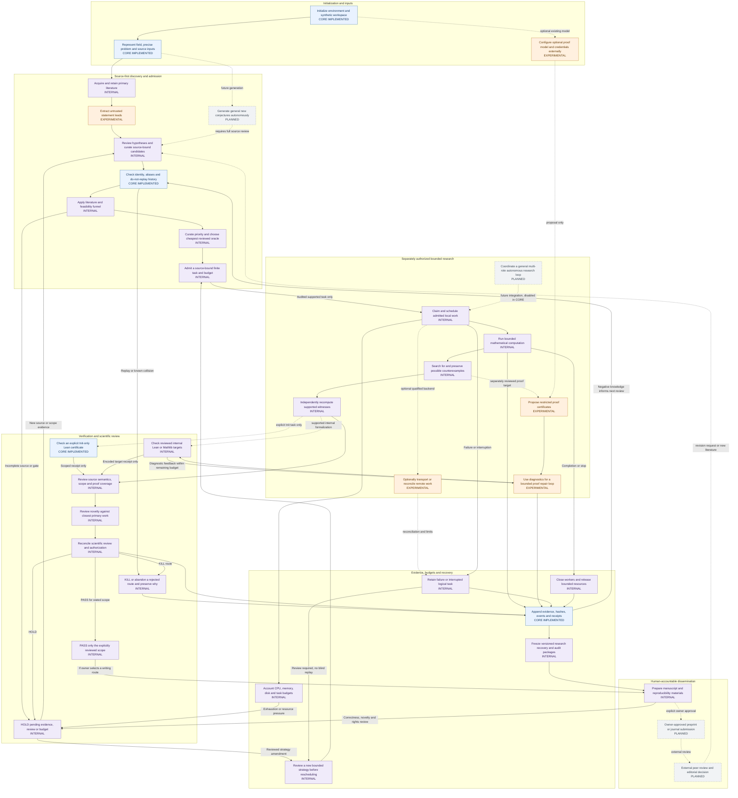

# Full Research Workflow

This is the implementation-grounded lifecycle of MathForge, inspected on 2026-10-20. The original CORE candidate is 58 files / 205,023 bytes before integration documents and existing brand assets. It is an audit framework with synthetic data, not the complete private research node. The private workspace was inspected read-only; no research was started for this documentation.

| Label | Meaning |
| --- | --- |
| CORE IMPLEMENTED | Present in the imported reusable CORE; only the stated scope is supported. |
| INTERNAL | Found in private code or retained research records; absent from this distribution. Some steps require human or agent review. |
| EXPERIMENTAL | A partial or optional implementation exists, with incomplete end-to-end qualification. |
| PLANNED | A design, contract or external future step; no implemented automatic capability is asserted. |

Implementation labels are independent of scientific outcomes. A gate PASS is scoped permission or evidence, not proof of originality or publication. INTERNAL does not mean currently running or universally automated. Solid arrows describe observed component handoffs or reviewed workflow order; dashed arrows denote optional or future handoffs, never a promise of automatic execution.

## End-to-end lifecycle

## How to read the feedback loops

1. **Literature loop:** extraction produces untrusted leads. A source/hypothesis gap or a newly found stronger result returns the task to source review. Semantic equivalence and mathematical judgment are not automated by schema validation.
2. **Research loop:** only separately authorized, admitted finite targets enter internal workers. Numerical screens lead to exact or independent checks where supported. No-witness sampling and timeouts remain bounded observations or failures.
3. **Proof loop:** an optional provider proposes restricted certificates for a fixed target. Compiler/kernel diagnostics may guide a bounded repair attempt. The provider has no verification authority; exhausted attempts remain HOLD.
4. **Scientific loop:** formal acceptance, source translation, analytic review and novelty are distinct. A failed encoded proof is not a false mathematical statement. New hypotheses require a newly reviewed record rather than rewriting old evidence.
5. **Recovery loop:** evidence survives crashes and exhausted budgets. Interrupted cells require reconciliation; new strategy cells require review, source/statement preservation and remaining lifetime budget.
6. **Dissemination loop:** manuscript preparation has internal artifact evidence. Preprint upload, journal submission and external review are owner-controlled future steps in this map. Reviewer feedback may reopen source/claim review; acceptance is not guaranteed.

## Execution boundaries

The foundational internal Phase 0 CLI and the distributed CORE both refuse research/proof state promotions. A separate private module has additive, owner-authorized bounded execution; it does not enable the foundational CLI. The public `AuditQueue` only executes `validate` and `export`. There is no hidden flag for enabling private research workers.

The public Lean adapter checks explicit Init-only tasks on the tested Windows toolchain. The internal verifier supports additional reviewed contexts/sources and Mathlib imports. Neither supplies automatic proof-to-natural-language equivalence, novelty clearance or whole-paper acceptance.

PASS / HOLD / KILL are workflow interpretations over component-specific receipts and review records. They are not one shared database enum or a universal gate API. See [actual states and loops](RESEARCH_LIFECYCLE.md), [module/data flow](SYSTEM_ARCHITECTURE.md), [capability matrix](CORE_VS_INTERNAL.md), and [every node's evidence and limits](WORKFLOW_EVIDENCE.md).
