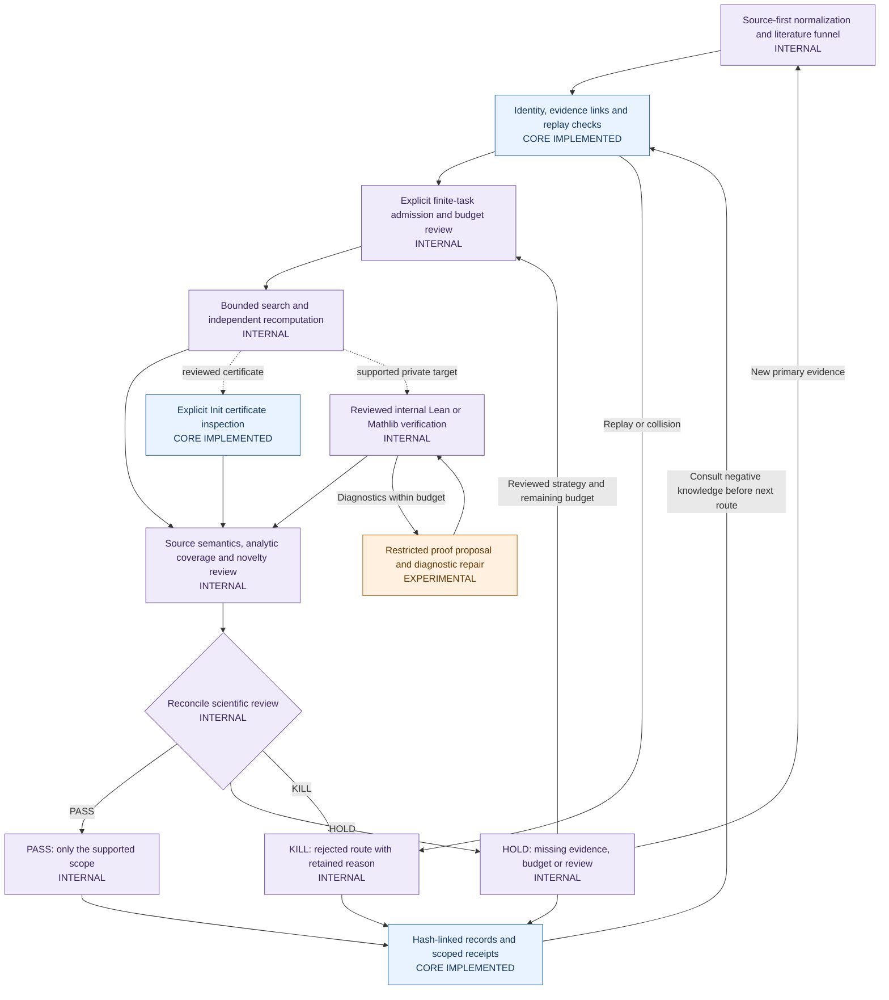
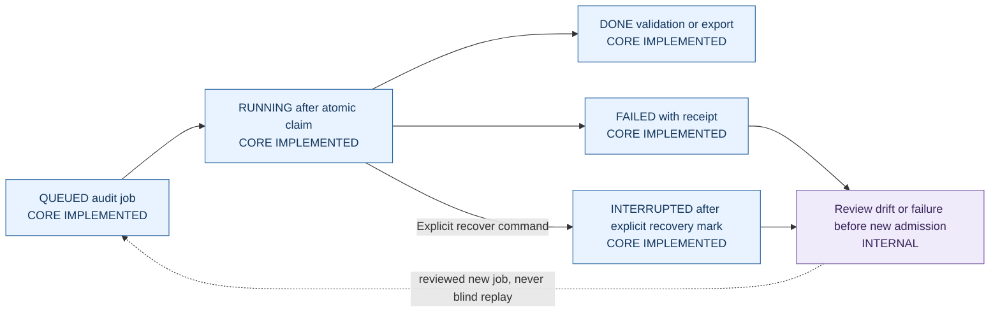

# Research Lifecycle, Gates and Feedback

| Label | Meaning |
| --- | --- |
| CORE IMPLEMENTED | Present in the imported reusable CORE; only the stated scope is supported. |
| INTERNAL | Found in private code or retained research records; absent from this distribution. Some steps require human or agent review. |
| EXPERIMENTAL | A partial or optional implementation exists, with incomplete end-to-end qualification. |
| PLANNED | A design, contract or external future step; no implemented automatic capability is asserted. |

Implementation labels are independent of scientific outcomes. A gate PASS is scoped permission or evidence, not proof of originality or publication. INTERNAL does not mean currently running or universally automated. Solid arrows describe observed component handoffs or reviewed workflow order; dashed arrows denote optional or future handoffs, never a promise of automatic execution.

## Scientific gates are separate obligations

| Gate or control | Actual implementation status | Consequence and limit |
| --- | --- | --- |
| Schema, identity and exact evidence links | CORE IMPLEMENTED: `engine.load_repository` | Reject malformed, duplicate or dangling records. This is structural validation. |
| Open-status freshness and scope binding | CORE IMPLEMENTED: `engine.check_open_evidence` | Requires the specifically supported official evidence adapter and exact statement binding. Arbitrary papers do not automatically become verified-open evidence. |
| Replay control | CORE IMPLEMENTED: `engine.replay_blocks`; INTERNAL admission binds negative-history hashes | Consult permanent negative knowledge. CORE forbids research execution irrespective of replay clearance. |
| Literature funnel | INTERNAL: `phase2a.FUNNEL`, `validate` | Ordered normalization, open status, terminology, stronger theorem, triviality, known computation, replay and tractability checks; failure/NOT_RUN stops later gates. `SURVIVES_AUDIT` is not a proof-search command. |
| Executable admission | INTERNAL: `local_research.admit` | Explicit source, scope, supported oracle, semantic identity and finite budget. Extracted leads remain HOLD. |
| Independent computational check | INTERNAL: worker and exact checker | Supports only implemented mathematical domains. Calibration and independent-method recomputation do not certify all code or prose. |
| Formal trust gate | CORE IMPLEMENTED Init adapter; INTERNAL richer reviewed gate | Exact encoded target, kernel, declarations and axiom checks. Compilation by itself is insufficient. Natural-language equivalence remains separate. |
| Novelty Gate | INTERNAL review records; CORE stores novelty metadata | Current primary-source comparison is required. UNKNOWN means HOLD for originality, not a proof failure. Internal bounded exploratory work can be separately authorized while retaining UNKNOWN. |
| Scientific Gate | INTERNAL convention across contracts and review records | Reconciles correctness, scope, novelty, evidence and authority. There is no universal automatic PASS/HOLD/KILL service in CORE. |
| Publication, rights and author approval | INTERNAL preparation, PLANNED external submission | Technical CI and Lean cannot clear ownership, author responsibility, journal acceptance or public-release authorization. |

## Three distinct kinds of state

**Foundational research states.** `orchestration/transitions.json` contains the broader design graph, including `PROOF_ATTEMPT`, `FORMALIZATION` and `PROVED`. The current CORE hard-codes only `MAPPED`, `OPEN_STATUS_UNVERIFIED`, `VERIFIED_OPEN`, `COLLISION_FOUND`, `BLOCKED` and `ABANDONED` as permitted transition destinations. An edge in the JSON graph is not permission to execute it. `BLOCKED` returns through status audit; terminal records are not silently reopened.

**Operational audit states.** These say whether an infrastructure job executed, not whether mathematics is correct:

**Internal scientific/runtime states.** The private executor additionally uses `AUDITED_FOR_BOUNDED_SEARCH`, `REVIEW_CANDIDATE`, `BUDGET_REVIEW`, `EXHAUSTED_NEEDS_NEW_RESEARCH_REVIEW`, `INTERRUPTED_REVIEW`, `FAILED_REVIEW`, `BLOCKED_SOURCE` and `BUDGET_SKIPPED`. Scientific records also carry scope-specific `HOLD_*`, `KILL_*`, audit-survival and review decisions. These are component-specific vocabularies, not aliases for CORE's enums. `DONE` never means `PROVED`.

## Feedback and stopping rules

- A promising numerical witness pauses the candidate for independent/source/formal/novelty review. Preserve the screen even if the independent checker is interrupted.
- A failed proof proposal returns diagnostics within a finite attempt/time budget; it does not change the target or establish a counterexample.
- Exhausted resources produce review states. Reconcile the old PID, creation time, result and receipt before considering a new task.
- Internal strategy amendments retain statement/source hashes and create explicitly reviewed bounded cells with lifetime limits. Neither public nor private recovery blindly recreates an interrupted logical cell.
- New evidence can reopen an audit; a corrected falsified statement needs a new linked record. Terminal-history correction requires a reviewable migration, not a rewritten baseline.
- Closing Windows Job/process/output handles releases controlled resources. It does not authorize deleting evidence, cleaning historical runs or discarding failed paths.

Publication decisions remain separate from internal analytic PASS, finite computational verification, scoped Lean receipts and novelty review. No published mathematical outcome is claimed by these diagrams.
