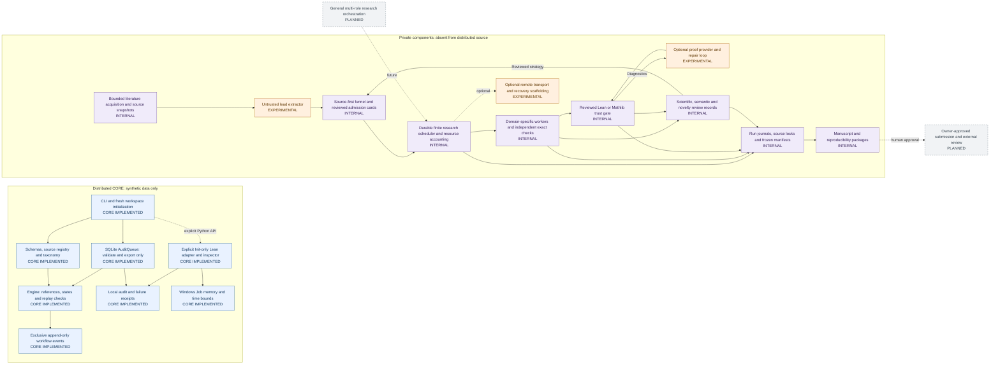

# System Architecture

The two boxes are different distributions and trust domains. Similar concepts do not imply that the public CLI can call a private worker. There is deliberately no executable edge across that distribution boundary.

| Label | Meaning |
| --- | --- |
| CORE IMPLEMENTED | Present in the imported reusable CORE; only the stated scope is supported. |
| INTERNAL | Found in private code or retained research records; absent from this distribution. Some steps require human or agent review. |
| EXPERIMENTAL | A partial or optional implementation exists, with incomplete end-to-end qualification. |
| PLANNED | A design, contract or external future step; no implemented automatic capability is asserted. |

Implementation labels are independent of scientific outcomes. A gate PASS is scoped permission or evidence, not proof of originality or publication. INTERNAL does not mean currently running or universally automated. Solid arrows describe observed component handoffs or reviewed workflow order; dashed arrows denote optional or future handoffs, never a promise of automatic execution.

## Real module boundaries

| Public module | Data and responsibility | Does not establish |
| --- | --- | --- |
| `workspace.py`, `cli.py` | Fresh synthetic workspace; validate, shortlist, replay-check, transition, export, demo and audit queue commands | Automatic literature intake, model configuration or research execution |
| `engine.py` and `schemas/` | Typed records, evidence links, exact shortlist scope, source freshness, alias/ID checks, hard-coded Phase 0 limits | Truth of prose, source authenticity, semantic theorem equivalence or independent novelty search |
| `engine.append_transition` | Exclusive lock, fsync and hash-linked workflow event append; stale-state refusal | Distributed consensus, signatures or resistance to a malicious complete history rewrite |
| `queue.AuditQueue` | SQLite atomic claim, idempotent binding, validate/export, failure receipts, explicit interrupted marking | Arbitrary shell jobs, proof search, research workers or a background daemon |
| `lean.py`, `certificates.py`, inspector template | Fixed certificate syntax, reviewed toolchain/template hashes, Init-only targets, kernel/type/axiom inspection | Mathlib execution, automatic model proof generation or whole-problem acceptance |
| `windows_budget.py` | Windows Job Objects and cleanup of controlled processes | Global CPU accounting, GPU scheduling or remote quota management |

## Data ownership and durability

CORE reads the canonical seed, source catalog, definitions, negative knowledge and current event chain. Its queue binds work to a digest of repository data, definitions and schema bytes; drift becomes a retained failure. Exports and receipts must stay under `reports/local/` and use new files/directories.

Private execution uses additional source-bound admission cards, a mutable SQLite operational queue, PID/create-time records, per-run JOB/code snapshots, immutable receipts and hash-linked scientific journals. Mutable heartbeat/status/SQLite files are operational views, not replacements for scientific evidence. Existing frozen manifests and historical anomalies remain evidence; this import does not publish them or silently repair them.

The internal scheduler has finite per-job, per-candidate and daily budgets, resource reserves and review pauses. The optional model provider and optional remote backend are separate from the trusted verifier. General ten-role coordination is a future integration, despite the existence of role contracts.

See [node-to-implementation evidence](WORKFLOW_EVIDENCE.md) for specific private paths and the limits of these observations.
